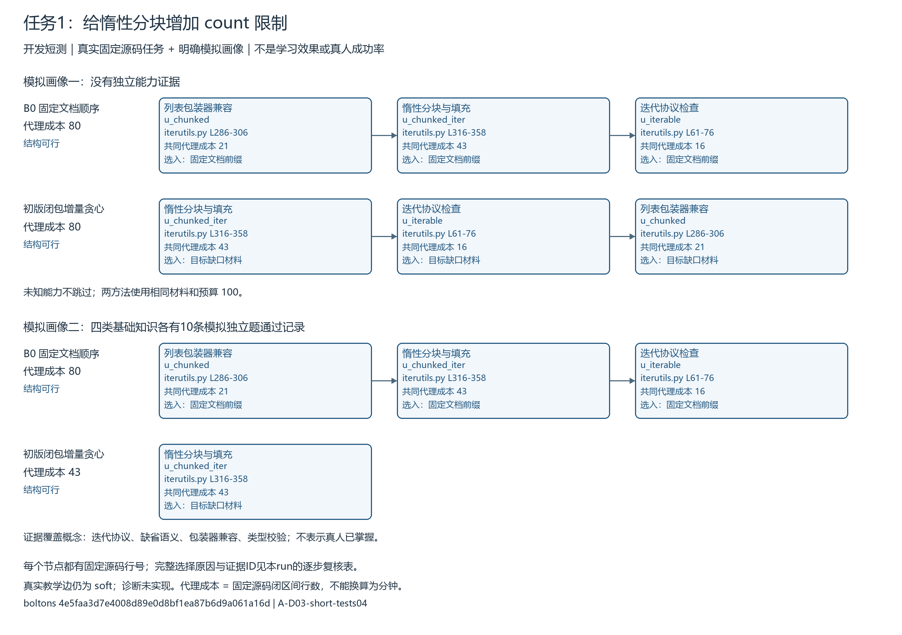

# CodeCompass：当前做到哪一步（A-D03）

实际执行：2026-10-16；任务卡日期：10月17日。Owner成员A，Codex Agent A，LAPTOP-LUQPS3EV。以B-D02真实提交fc6485329691efda2662e21116d8f23e329b4d96为前置。

当前工程测试已通过，提交后复跑与远程同步结论见 [最终放行记录](../../experiments/A/A-D03-closeout/release_gate.json)；记录不存在或next_step_allowed不为true时，不得据此提前进入下一棒。

## 先看成果，不需要写代码

1. 打开下方任务1图：上半部分是“没有能力证据”的模拟画像，下半部分是“四类基础概念各有10条模拟独立通过记录”。左侧比较B0固定文档路线与本轮初版算法。
2. 注意：无证据时两条路线成本同为80；有证据时初版只留下chunked_iter，成本43。变化来自模拟证据门控，不是真人学习效率结果。
3. 看任务2图（60与39代理单位）和预算不足图；后者必须显示未找到完整路线，不能显示任务完成。
4. 想核对每一步，打开[逐步复核表](../../report_materials/A/A-D03/A-D03-short-tests04/逐步复核.md)，其中列有每个节点的固定源行号、成本、原因、证据ID和剩余约束。



[任务2路线图](../../report_materials/A/A-D03/A-D03-short-tests04/task_002_paired_routes.png) · [失败案例图](../../report_materials/A/A-D03/A-D03-short-tests04/failure_budget_route.png)

## 当前累计能力

| 层面 | 当前事实 | 尚未完成 |
|---|---|---|
| 数据与来源 | 七对象契约；固定boltons局部源码；B的12道候选任务及独立评分工程 | 题目人类审核/时长预演；不是全库覆盖 |
| 代码图 | AST包含/导入、字节哈希、source_span；未知调用标unknown | 动态绑定/运行调用图 |
| 能力 | 独立证据纯函数更新、按用户/题目去重、Beta下界门控 | B-D03持久化、重启恢复、真实能力测量 |
| 规划 | 目标闭包、共享前置去重、增量成本贪心、原因链、独立合法性回放 | beam/Ours、诊断、正式优化/学习效果验证 |
| 可见入口 | 本页、3张中文配对/失败图、可实时执行的独立CLI | 正式UI；原app尚未接入本轮planner |
| G1 | A算法可执行子关卡复检，放行以release_gate为准 | B-D03能力+Issue闭环T3；不能提前跳A-D04 |

## 可选：一步一步运行，观察实时输出

以下已由Agent自行执行并记录，不要求你重复验收。Windows PowerShell打开项目目录，逐行执行：

```powershell
Set-Location 'D:\AIC算法主题赛'
$py = '.\tmp\A-D02-venv\Scripts\python.exe'
& $py scripts/A/demo_d03.py
```

应看到“明确模拟、不是真人”，B0成本80，初版路线只有u_chunked_iter、成本43，状态FEASIBLE。若换了电脑没有这个环境，按[scripts/A/README_D03.md](../../scripts/A/README_D03.md)先创建隔离环境，不要随意安装仓库脚本。

接着执行：

```powershell
& $py scripts/A/demo_d03.py --profile sim_unknown
& $py scripts/A/demo_d03.py --task task_002
& $py scripts/A/demo_d03.py --profile sim_unknown --budget 20
```

第一条应初版成本80、不跳过未知知识；第二条初版成本39；第三条两方法均NO_FEASIBLE_FOUND，初版保留u_iterable、成本16，并列剩余目标/预算约束。退出0表示演示运行成功，不表示失败案例变成可行路线。

## 严格检查证据

[累计测试/命令](../../experiments/A/A-D03-verification02/commands.json)（103测试通过；故意负预算的预期退出2） · [独立于贪心选点的回放/41负例挑战](../../experiments/A/A-D03-audit02/audit.json) · [G1审查](G1算法可行性与创新审查.md) · [B-D03交接](handoffs/A-D03.md)。正式实验0、真人画像0、人类审核未进行。无需你编写任务答案来让本日工程验收通过。
