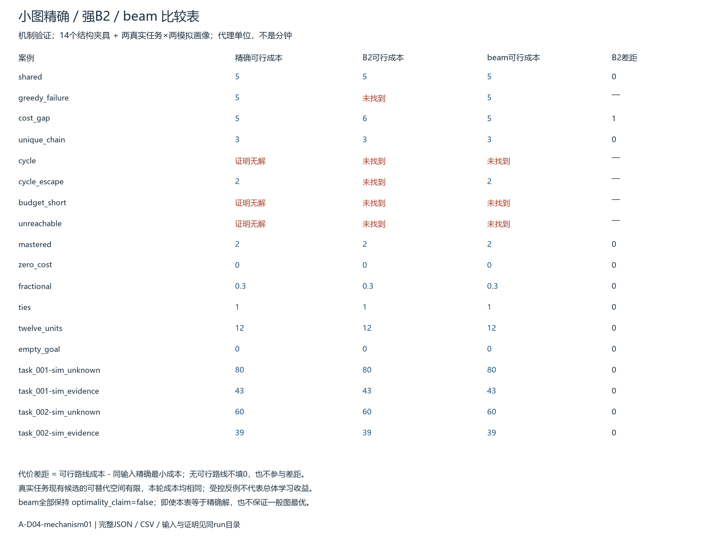

# A-D04：今天与累计成果怎么查看

计划日10月18日，实际2026-10-16执行。Owner成员A，Codex Agent A，LAPTOP-LUQPS3EV。基于B-D03远程5b3db98407ea47e1f26c7ff4cd7594cb42305aea。严格工程复检、提交归档复跑与远程检查点同步通过，允许进入下一步B-D04。证据见[release_gate](../../experiments/A/A-D04-closeout/release_gate.json)。

## 第一步：直接看结果

打开下方完整比较表：每行是同一输入，三列共用候选/画像/成本/图。“未找到”不能填成0；“证明无解”只给精确完成且证书验证通过的情况。cost_gap是受控结构夹具：B2成本6、beam/精确5。真实任务四行成本均相同，不能据此宣称beam提高真实学习效率。



## 第二步：看为什么这样选

[F03状态框架](../../report_materials/A/A-D04/A-D04-mechanism01/F03_search_framework.png) · [决策过程图](../../report_materials/A/A-D04/A-D04-mechanism01/beam_decision_trace.png) · [全部机器可读结果](../../experiments/A/A-D04-mechanism01/summary.json) · [逐案例人工可读表](../../report_materials/A/A-D04/A-D04-mechanism01/比较与复核.md)。输入、完整精确证书、每轮候选/去重/截断在同run的cases目录。

## 第三步：可选，自己运行实时比较

自动检查Agent已自行完成；以下供你观察，不要求你做编程题。PowerShell逐行：

```powershell
Set-Location 'D:\AIC算法主题赛'
$py = '.\tmp\A-D02-venv\Scripts\python.exe'
& $py scripts/A/demo_d04.py
```

预期cost_gap：精确路线b成本5，B2路线a→c成本6，beam路线b成本5，独立合法性True；beam最优性声明始终False。

继续逐条观察：

```powershell
& $py scripts/A/demo_d04.py --case unique_chain
& $py scripts/A/demo_d04.py --case greedy_failure --beam-width 1 --candidate-limit 1 --certify-small
& $py scripts/A/demo_d04.py --case unreachable --certify-small
& $py scripts/A/demo_d04.py --time-limit 0
```

依次应看到：三者成本都3（没有优势也保留）；beam未找到但精确另有可行见证（不能写无解）；证书验证后INFEASIBLE_PROVEN；最后beam真实零秒搜索预算触发TIMEOUT。状态案例是机制夹具/模拟输入，均不是真人实验。换电脑先按[scripts/A/README_D04.md](../../scripts/A/README_D04.md)建hash锁环境。

## 当前累计做到哪里

| 层面 | 已实现 | 未完成/限制 |
|---|---|---|
| 固定源码与图 | 来源、AST、span/hash、软/硬边区分 | 动态调用unknown；真实硬教学边未人工审核 |
| 能力与闭环 | B-D03事务存储/去重/重启恢复/用户隔离、公开Issue准备CLI，经本机接收复验 | 非网络认证；真人能力/Issue推荐准确率未测 |
| 规划比较 | B2原实现、beam、<=12精确DP、独立重放与完整证书、四状态 | 无一般最优保证；真实任务本轮平局 |
| 可见成果 | 本页、三对PNG/SVG、实时比较CLI、54结果+4状态+16宽度 | 正式GUI未做；B应用尚未接入新beam接口 |
| 研究机制 | 来源与机制正确性可复现 | 诊断/切换惩罚/个性化成本标定未实现；正式学习实验0 |

严格复检证据：[运行命令](../../experiments/A/A-D04-verification01/registration.json)、[206负例审计](../../experiments/A/A-D04-audit01/audit.json)、[算法/伪代码/复杂度](algorithm.md)、[下一棒交接](handoffs/A-D04.md)。独立人类审核未进行；Agent自审不会冒充人类审核。

最终累计142项测试通过，206个篡改输出被拒绝，归档完整重算结果一致。A-D04本轮未出现未修复工程失败；真实任务成本收益、真人效果和B应用beam接线仍未完成。
